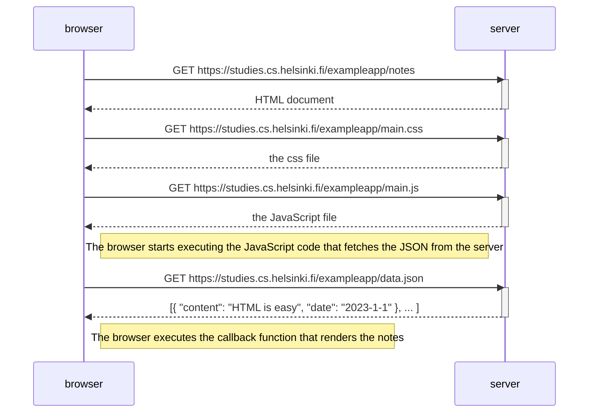
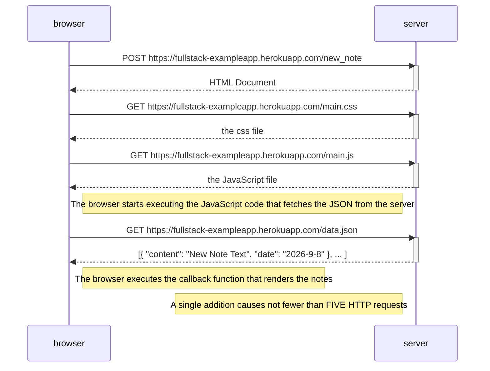
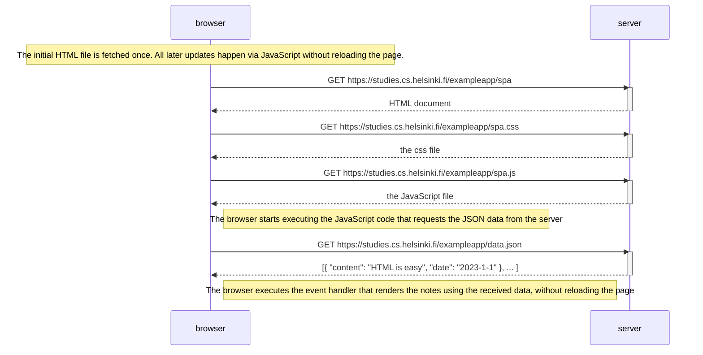
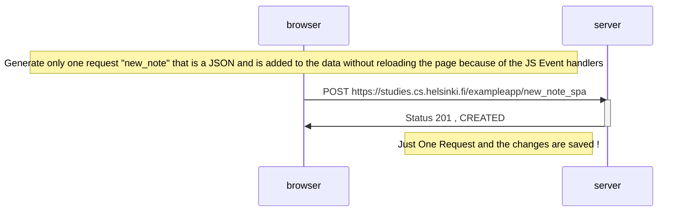

                                        Part 0.4

                                        Part 0.4- New Note Addition

                            Part 0.5- Single Page Application

Part 0.6 - New Note in SPA

